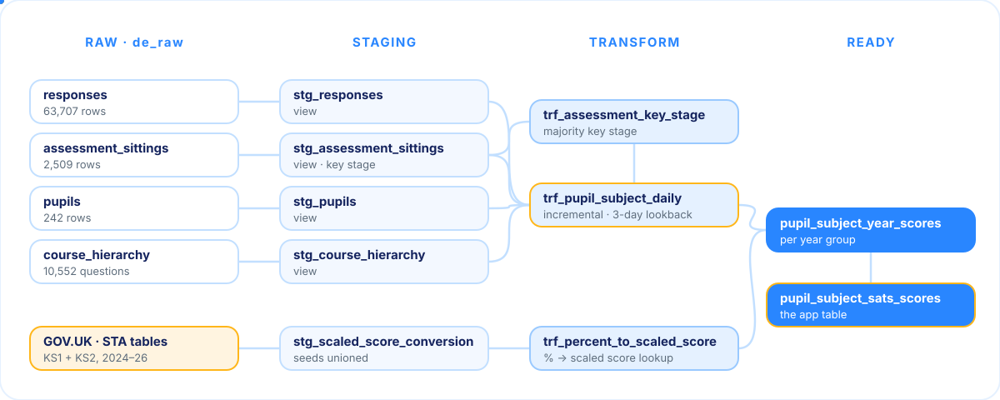
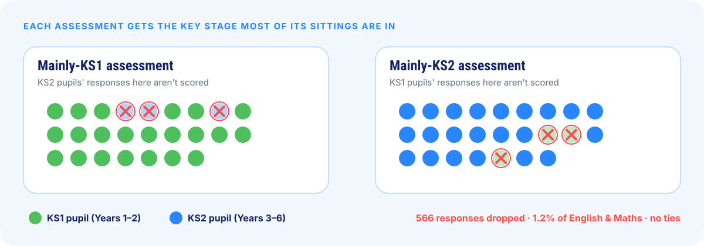
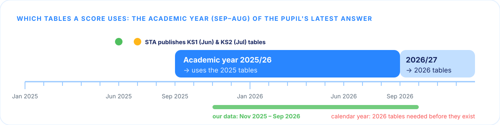

<p align="center">
  
</p>

<p align="center">


<p align="center">
  
</p>

## The task, and how I approached it

Atom's app needs a **SATs-style scaled score** for every pupil in every subject: the same 80–120
scale the government uses for KS2 tests. It has to be re-runnable, recomputable as at any date and
ready to drop into the app database.

**How I got here.** I started by exploring the raw data in BigQuery, then read the government's
published scaled-score tables to understand exactly what a "SATs-style" score means and how STA
converts raw marks. With that grounding, I worked with Claude to plan the build and identify the
pitfalls up front: point-in-time correctness, incremental loading at scale, and data quality traps.
Profiling then challenged several of the plan's assumptions, so the approach deviated from the
original plan along the way, each change recorded in [`ai/planning_log.md`](ai/planning_log.md).

Four principles shaped everything:

| | |
|---|---|
| 🎯 **Start from the why** | The scores aren't the end product: they'll be shown to pupils and parents in the app, and used as features for predictive modelling.  |
| 🔍 **Profile before modelling** | No model was written until 28 profiling queries had been run. Several starting assumptions turned out wrong, and every decision below points back to the evidence in [`analyses/FINDINGS.md`](analyses/FINDINGS.md). |
| 📐 **Use the official curves** | Scores come from the STA's published conversion tables, fetched from GOV.UK and stored as seeds, never a home-made formula. KS1 pupils use the KS1 tables, KS2 pupils the KS2 tables. |
| ✂️ **Keep it simple** | Plain, readable SQL enforced by SQLFluff. Every model is short enough to read top to bottom. |

---

## How it works

<p align="center">
  
</p>

| Layer | What happens | Why |
|---|---|---|
| **Staging** | Views over the four source tables, with only the columns that are used. Soft deletes are filtered here, and each sitting gets the pupil's key stage. The STA seeds are unioned into one conversion table. | One place for cleaning. Views stay current and cost nothing to store. |
| **Transform** | `trf_pupil_subject_daily` counts answered and correct per pupil × subject × year group × day. It's the only model that touches the big table, and it's **incremental**: it overwrites the last 3 days' partitions. `trf_assessment_key_stage` decides each assessment's key stage, and `trf_percent_to_scaled_score` is a lookup from % to scaled score. | `responses` is expected to grow past 100m rows. Everything downstream reads a table of about 1,400 rows instead. |
| **Ready** | `pupil_subject_year_scores` holds a score per year group. `pupil_subject_sats_scores` is the **app table**, one row per pupil × subject, taken from their latest year group. | A flat, long table with a clear key `(pupil_id, subject_name)` is the easiest thing for an app database to consume. |

---

## Turning answers into a scaled score

Atom's assessments are shorter than real SATs papers and vary in length, so a raw total can't be
looked up directly. Instead, each pupil's answers are converted through a percentage:

<p align="center">
  
</p>

1. **Add up** every in-scope answer the pupil gave in that subject while in that year group. A skipped question counts as wrong, as on a real paper.
2. **Percentage correct**, rounded down to a whole percent.
3. **Equivalent raw mark** on each official test: `⌊percent × full marks ÷ 100⌋`. It rounds down because raw marks are earned.
4. **Official STA table** for the pupil's key stage and academic year. English averages its reading and grammar, punctuation & spelling (GPS) scores.
5. **Scaled score.** 100 or more means the pupil meets the expected standard.

Steps 3–5 are worked out once for every whole percent in a small lookup table, so scoring a pupil is
a single join.

**Why not just stretch the percentage across 80–120?** Because the official curve isn't a straight
line:

<p align="center">
  
</p>

---

## Key decisions

### Each key stage on its own scale, and only matching assessments

KS1 pupils (Years 1–2) are scored on the official **KS1 tables (85–115)**, KS2 pupils (Years 3–6)
on the **KS2 tables (80–120)**. Every score carries its `key_stage`: a KS1 100 and a KS2 100 both
mean "expected standard", but they aren't the same score.

Some assessments are sat by both key stages, so each assessment is assigned the key stage **most of
its sittings** are in (a tie goes to KS2, the harder content). A pupil's answers only count when
their key stage matches the assessment's. That way a Year 2 pupil stretching to KS2 work, or a Year 5
pupil revising KS1 work, doesn't distort their score.

<p align="center">
  
</p>

### Tables follow the academic year, not the calendar

STA publishes each year's tables in June (KS1) and July (KS2), just before the school year they
apply to. A score uses the tables for the **academic year** of the pupil's latest answer, so a score
never depends on a table that didn't exist yet, and adding next year's tables never changes old
scores.

<p align="center">
  
</p>

### The rest, at a glance

| Decision | Why |
|---|---|
| **One score per year group**; the app shows the latest | A Year 5 score isn't diluted by Year 2 work. The trade-off is that early in a school year the score rests on few answers, so `n_answered` is shipped alongside it. |
| **Maths and English get scaled scores; Screeners and Verbal / Non-Verbal Reasoning get % correct** | Only Maths, reading and GPS have SATs tests. Screeners are diagnostics, and VR / NVR are 11+ aptitude, not KS2 curriculum. |
| **Science and Wellbeing aren't included** | Science has 335 questions but no answers yet (it appears automatically when it has some). Wellbeing is surveys with no right answers. |
| **English = ½ reading + ½ GPS** | Atom's English covers both, and topic names aren't available to split them. |
| **Long app table, not wide** | A new subject is new rows, not a schema change in the app; "all Maths scores" is a simple `WHERE`. |
| **Point-in-time via `as_at`** | `dbt build --vars '{as_at: "2026-03-01"}'` adds up only earlier answers. Nothing uses `current_date()`, so the same inputs always give the same output. |
| **Conversion tables are data** | They're fetched by `scripts/build_conversion_seed.py`, validated, and stored as seeds with their GOV.UK source pages, so adding a year is one command. |

---

## What the data told us

<p align="center">
  
</p>

- 🧩 **56 sittings are missing.** 1,433 answers point at sittings that don't exist, so they have no style, year group or deleted flag. They're **excluded** and flagged by a warning test. The pupils are real, so a next step could score them with an assumed style.
- 🔁 **Repeated rows.** 4,493 answers (7%) repeat the same question in the same sitting at the same second, sometimes with different outcomes. The evidence says duplicates, not multi-mark questions: `total_questions` counts each question once in 709 of 749 affected sittings. **All rows are kept**: we can't tell which copy is real, and keeping all of them is neutral on average. This is worth raising with the platform team.
- ✅ **What's clean:** keys are unique with no nulls, there are no soft deletes, and every question belongs to exactly one subject.

Full log with every number: [`analyses/FINDINGS.md`](analyses/FINDINGS.md).

---

## Results

<p align="center">
  
</p>

- **45 dbt tests pass** (plus 1 expected warning for the missing sittings).
- **Re-runnable:** row counts and checksums are identical after a full refresh and an incremental run.
- **Hand-checked:** four scores recomputed straight from the raw data match the model exactly.


---

## Predicting GCSE grades

<p align="center">
  
</p>

*Brief, step 3: how might we predict a pupil's GCSE results from their primary-school work, and
what would we need: data, assumptions and why.*

**The model.** I'd treat it as one prediction per GCSE subject: the probability of each grade 1–9.
Gradient-boosted trees (**XGBoost** and **LightGBM**, compared on the same folds) suit this well.
They handle missing years and non-linear effects natively, work on a few thousand pupils, and their
predicted probabilities can be calibrated. A national baseline (below) is the benchmark they must
beat.

**The features**: one row per pupil, built from the tables in this repo:

| pupil_id | y1_maths_scaled | y1_english_scaled | … | y6_maths_scaled | y6_english_scaled | y5_vr_pct | y5_nvr_pct | screeners_pct | answers_per_week | skip_rate | … |
|---|---|---|---|---|---|---|---|---|---|---|---|
| p_001 | 101 | 98 | … | 106 | 103 | 72 | 64 | 58 | 41 | 0.03 | … |

- **Scaled score and % correct per subject per year group** (Year 1 → Year 6, every subject). This captures the *trajectory* as well as the level, which is why the build scores each year group separately.
- **Aptitude**: Verbal / Non-Verbal Reasoning and Screeners, which SATs don't measure.
- **Engagement**: volume, consistency, skip rate and time per question.
- **Context**, used carefully: school and area deprivation help, but can encode disadvantage rather than ability, so they're also used to check the model is fair across groups.

**The data we'd need, and the catch.** The target is real GCSE results, and a Year 6 pupil sits
GCSEs five years later. So:

1. **Ideally: Atom's own longitudinal data.** Pupils followed from Year 1 (or as early as we have) through to their GCSE results, linked by consent or by surveying families. That means years of history before the first model can be trained.
2. **If we don't have that yet: use what exists.** The DfE's **KS2 → KS4 transition matrices** give the national GCSE grade distribution for each KS2 scaled-score band, so our Year 6 scores can be mapped onto them for a defensible first prediction with no Atom outcomes at all. National KS2 results show whether Atom pupils are typical. A **National Pupil Database** application gives pupil-level KS2 → GCSE histories to train on.

**Assumptions, and why they matter**

- **Our scores mean the same over time and match real SATs.** The national matrices are keyed on real KS2 scaled scores, so the mapping only holds if ours are comparable. That's the reason for using the official STA tables rather than a home-made scale.
- **Past cohorts resemble future ones**, and the KS2 → GCSE relationship is stable. Grading changes and COVID break this: KS2 tests were cancelled in 2020 and 2021, so DfE can't calculate Progress 8 for 2024/25 or 2025/26, and those cohorts can't be used to learn the link.
- **Atom users may not be representative.** They're self-selected, often motivated families, so a national baseline needs recalibrating to the platform.
- **Five years is a long time.** The output should be a **grade distribution** (e.g. "70% chance of a 6 or above"), not a single grade, refreshed as new answers arrive.

**Most relevant public data**

| Dataset | Use | Source |
|---|---|---|
| KS2 → KS4 transition matrices (GCSE subjects) | National grade distribution by KS2 score band and subject: the baseline | [Explore education statistics](https://explore-education-statistics.service.gov.uk/data-catalogue/data-set/a317ce4a-07cc-4090-9d88-cd4c47527058) |
| Key stage 4 performance | GCSE outcomes nationally and by school | [Explore education statistics](https://explore-education-statistics.service.gov.uk/find-statistics/key-stage-4-performance) |
| KS2 attainment | National scaled-score distribution, to calibrate Atom pupils | [Explore education statistics](https://explore-education-statistics.service.gov.uk/find-statistics/key-stage-2-attainment-national-headlines) |
| National Pupil Database | Linked pupil-level KS2 → GCSE results to train on, by application | [Apply for DfE data](https://www.gov.uk/guidance/apply-for-department-for-education-dfe-personal-data) |

---

## Limitations and next steps

- **Score the 1,196 English / Maths answers whose sitting is missing**, using an assumed style.
- **Confirm the repeated rows** with the platform team; if they're duplicates, de-duplicate at source.
- **Whole-percent lookup** can be about 1 point low near a boundary on KS2 Maths (1% ≈ 1.1 marks); 0.1% steps would be a one-number change.

---

<details>
<summary><b>🛠️ Running it locally</b></summary>
<br>

Requires [uv](https://docs.astral.sh/uv/) and the gcloud CLI.

```sh
uv sync                                          # Python 3.12 + pinned dbt-core / dbt-bigquery
gcloud auth application-default login            # OAuth for BigQuery
uv run dbt deps
uv run dbt build                                 # needs ~/.dbt/profiles.yml, below
uv run dbt build --vars '{as_at: "2026-03-01"}'  # point-in-time run
uv run sqlfluff lint models tests analyses       # SQL style (fix: sqlfluff fix ...)
```

`~/.dbt/profiles.yml` (not committed):

```yaml
atom_ks2:
  target: dev
  outputs:
    dev:
      type: bigquery
      method: oauth
      project: atom-analytics-candidates
      dataset: james_oakley
      location: europe-west2
      threads: 4
      job_execution_timeout_seconds: 300
```

**New conversion tables** (STA publishes KS1 in June, KS2 in July):

```sh
uv run python scripts/build_conversion_seed.py ks2 2027   # fetch, validate, write the seed
uv run dbt build
```

**Profiling and verification queries:**

```sh
uv run python scripts/run_analyses.py            # dry run: GB per query
uv run python scripts/run_analyses.py --run 29 30 31 32
```

**README images** are generated from the seeds and verified numbers:
`uv run python scripts/make_readme_assets.py`.
</details>

<details>
<summary><b>📋 Output tables and columns</b></summary>
<br>

All tables are in `atom-analytics-candidates.james_oakley`.

| model | grain | key |
|---|---|---|
| `pupil_subject_sats_scores` | pupil × subject (latest year group): **the app table** | `(pupil_id, subject_name)` |
| `pupil_subject_year_scores` | pupil × subject × year group | `(pupil_id, subject_name, year_group)` |
| `trf_percent_to_scaled_score` | key stage × table year × subject × whole percent | |
| `trf_assessment_key_stage` | assessment | `assessment_id` |
| `trf_pupil_subject_daily` | pupil × subject × year group × day (incremental) | |

`pupil_subject_sats_scores` columns: `pupil_id`, `subject_name`, `key_stage`, `year_group`,
`scaled_score` (Maths / English only; KS1 85–115, KS2 80–120), `percent_correct`, `n_answered`,
`n_correct`, `conversion_table_year`, `last_answered_date`. A pupil with no answers in a subject
has no row for it.
</details>

<details>
<summary><b>📁 Repository layout</b></summary>
<br>

```
models/
  staging/     views over de_raw; stg_scaled_score_conversion (generated union of the seeds)
  transform/   trf_pupil_subject_daily, trf_assessment_key_stage, trf_percent_to_scaled_score
  ready/       pupil_subject_year_scores, pupil_subject_sats_scores
seeds/         scaled_scores/ (STA KS1 + KS2 tables per year), seed_subject_to_test.csv
tests/         singular tests (weights sum to 1, every Maths / English score finds a table)
analyses/      32 profiling and verification queries + FINDINGS.md
scripts/       build_conversion_seed.py, run_analyses.py, make_readme_assets.py
docs/assets/   README illustrations (generated)
ai/            planning log and saved GOV.UK source pages
```
</details>

<details>
<summary><b>🤖 How AI was used</b></summary>
<br>

This project was built with Claude Code. [`ai/planning_log.md`](ai/planning_log.md) records every
decision and change of direction with the date and the reason. [`PLAN.md`](PLAN.md) and
[`CLAUDE.md`](CLAUDE.md) are the working plan and the conventions the AI followed, and
`ai/sources/` holds the GOV.UK pages the conversion tables came from. Every query and model was
checked against the data in `analyses/`, and the scoring was hand-checked from the raw tables.
</details>
